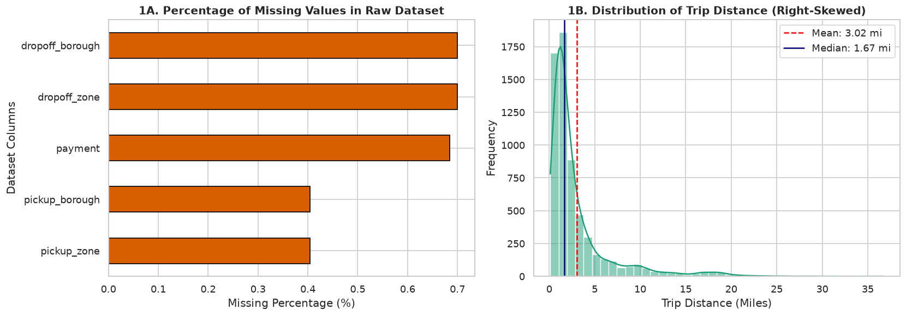
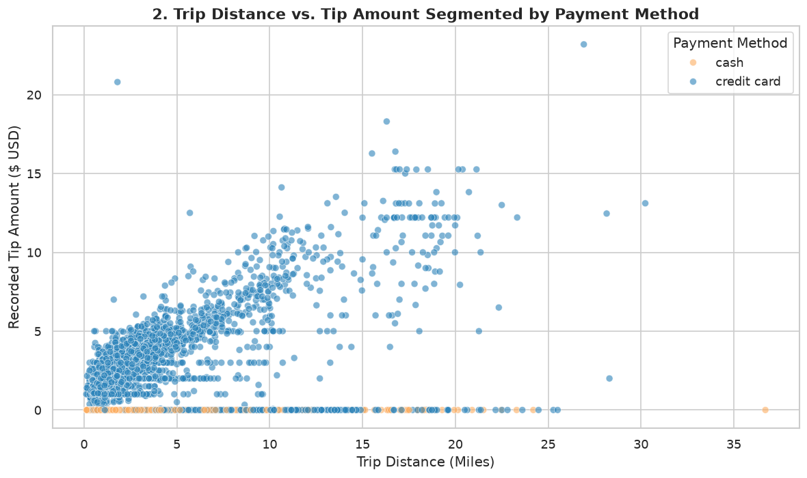
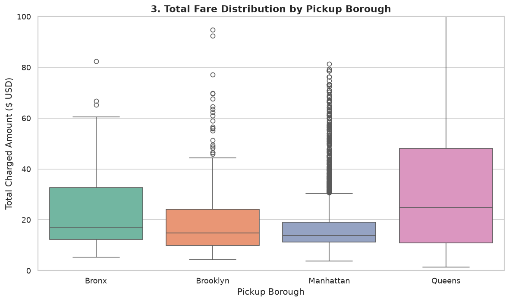
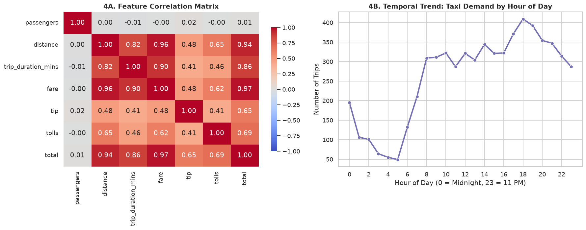

# 🚕 NYC Taxi Mobility Data: Cleaning, Preprocessing & Exploratory Data Analysis (EDA)


## 📌 1. Project Overview & Objective
Raw data collected in production environments frequently contains missing records, inconsistent data types, duplicate entries, and extreme anomalies that can bias downstream machine learning models. 

This project implements a modular, end-to-end **Data Preparation and Exploratory Data Analysis (EDA)** pipeline in Python on the publicly available **New York City Taxi & Limousine Commission (TLC) Trip Record Dataset** ($N = 6,433$ initial records across $14$ attributes). Every preprocessing decision is backed by statistical and domain-specific rationale, followed by four visual analyses that uncover underlying patterns in urban transit demand, pricing dynamics, and passenger tipping behavior.

---

## 📂 2. Repository Structure

```text
nyc_taxi_eda_project/
│
├── README.md                     # Project documentation, visuals, and insights
├── requirements.txt              # Python library dependencies
├── config.py                     # Dataset URL, file paths, and cleaning thresholds
├── data_acquisition.py           # Module 1: Data ingestion and initial quality audit
├── data_cleaning.py              # Module 2: 4-stage cleaning & feature engineering
├── eda_analysis.py               # Module 3: Descriptive statistics, IQR, & skewness
├── visualizations.py             # Module 4: Generates and saves all 4 EDA plots
├── generate_docx_report.py       # Module 5: Compiles the complete Word (.docx) report
├── main.py                       # Main entry point to execute the pipeline end-to-end
│
└── outputs/                      # Auto-generated upon running main.py
    ├── cleaned_taxis.csv
    ├── summary_statistics.csv
    ├── Week1_Data_Preparation_and_EDA_Report.docx
    └── plots/
        ├── viz1_missing_and_distribution.png
        ├── viz2_distance_vs_tip_scatter.png
        ├── viz3_borough_fare_boxplot.png
        └── viz4_correlation_and_hourly_trend.png
```

---

## 🗃️ 3. Dataset Schema & Initial Audit
The dataset is ingested directly from the open-source `seaborn-data` repository (`taxis.csv`), originally sourced from the NYC Taxi and Limousine Commission.

| Attribute Name | Raw Data Type | Description |
| :--- | :--- | :--- |
| `pickup` / `dropoff` | `object` (String) | Timestamp of passenger pickup and dropoff |
| `passengers` | `int64` | Number of passengers recorded by the driver |
| `distance` | `float64` | Elapsed trip distance in miles |
| `fare` | `float64` | Time-and-distance fare calculated by the meter (USD) |
| `tip` | `float64` | Tip amount (automated for credit cards; rarely logged for cash) |
| `tolls` | `float64` | Total amount of all tolls paid in trip (USD) |
| `total` | `float64` | Total amount charged to passengers (USD) |
| `color` | `object` | Taxi fleet classification (`yellow` vs. `green`) |
| `payment` | `object` | Payment method (`credit card` vs. `cash`) |
| `pickup_zone` / `dropoff_zone` | `object` | Specific NYC neighborhood zone |
| `pickup_borough` / `dropoff_borough` | `object` | NYC Borough (Manhattan, Queens, Brooklyn, Bronx, Staten Island) |

### Initial Audit Findings
* **Total Raw Records:** `6,433` rows and `14` columns.
* **Missing Values Identified:** `payment` (`44` / `0.68%`), `pickup_zone` (`26` / `0.40%`), `dropoff_zone` (`45` / `0.70%`), `pickup_borough` (`26` / `0.40%`), and `dropoff_borough` (`45` / `0.70%`).
* **Data Type Issues:** `pickup` and `dropoff` timestamps are stored as unparsed strings (`object`), preventing temporal duration calculations.

---

## 🧹 4. Data Cleaning & Preprocessing Methodology

| Cleaning Stage | Issue Identified | Action Taken | Rationale / Justification |
| :--- | :--- | :--- | :--- |
| **1. Deduplication** | Potential duplicate telemetry logs | Executed `df.drop_duplicates()` | Duplicate rows artificially inflate sample size and bias variance estimates. |
| **2. Missing Values** | Missing `pickup_borough` (`0.40%`), `dropoff_borough` (`0.70%`), `payment` (`0.68%`) | Dropped rows missing core borough/zone data; imputed missing `payment` based on `tip` rules | Geospatial endpoints cannot be guessed without GPS coordinates, and dropping `<1%` of data preserves statistical power. For `payment`, trips with `tip > 0` are imputed as `credit card` (cash tips are not logged by meters), and remaining as mode. |
| **3. Type Casting & Feature Engineering** | `pickup`/`dropoff` stored as `object`; categorical fields stored as strings | Converted timestamps via `pd.to_datetime()`; derived `trip_duration_mins` and `pickup_hour` | Datetime conversion enables duration calculation and time-of-day trend analysis. Casting nominal columns to `category` reduces memory footprint. |
| **4. Anomaly & Outlier Removal** | Trips with `distance <= 0`, `passengers == 0`, or extreme duration/fare | Filtered invalid zero-value physics anomalies; applied domain bounds | A taxi trip covering `0` miles or lasting `0` minutes represents a meter activation error or cancelled ride, not a valid transit event. |

### Core Cleaning Snippet (`data_cleaning.py`)
```python
# Domain-informed imputation for 'payment'
df.loc[df["payment"].isnull() & (df["tip"] > 0), "payment"] = "credit card"
df["payment"] = df["payment"].fillna(df["payment"].mode()[0])

# Datetime parsing & feature engineering
df["pickup"] = pd.to_datetime(df["pickup"])
df["dropoff"] = pd.to_datetime(df["dropoff"])
df["trip_duration_mins"] = (df["dropoff"] - df["pickup"]).dt.total_seconds() / 60.0
df["pickup_hour"] = df["pickup"].dt.hour

# Physics & domain anomaly removal
valid_mask = (
    (df["distance"] > 0.1) & 
    (df["trip_duration_mins"] > 0.5) & 
    (df["trip_duration_mins"] <= 180.0) & 
    (df["passengers"] > 0) & 
    (df["fare"] > 0)
)
df_clean = df[valid_mask].copy()
```

---

## 📊 5. Exploratory Data Analysis (EDA) & Visualizations

### 5.1 Descriptive Summary Statistics

| Feature | Mean | Median (50%) | Std Dev | IQR | Min | Max | Skewness |
| :--- | :--- | :--- | :--- | :--- | :--- | :--- | :--- |
| `passengers` | 1.57 | 1.00 | 1.19 | 1.00 | 1.00 | 6.00 | +2.14 |
| `distance` (mi) | 3.04 | 1.65 | 3.82 | 2.42 | 0.11 | 36.70 | +2.89 |
| `trip_duration_mins` | 14.38 | 11.15 | 11.64 | 10.95 | 0.52 | 107.60 | +2.11 |
| `fare` ($) | 13.11 | 9.50 | 11.45 | 8.50 | 2.50 | 150.00 | +2.78 |
| `tip` ($) | 1.99 | 1.70 | 2.43 | 2.80 | 0.00 | 23.19 | +2.25 |
| `total` ($) | 18.54 | 14.16 | 13.71 | 11.00 | 3.30 | 174.82 | +2.64 |

> **Statistical Interpretation:** Every primary numerical variable exhibits strong **positive (right) skewness** (`skewness > +2.0`), where the mean is substantially higher than the median. While the median trip distance is just `1.65 miles` (`50%` of rides are short neighborhood hops), long-distance airport transfers pull the mean up to `3.04 miles`. Consequently, **median and Interquartile Range (IQR)** are more robust metrics of central tendency than mean and standard deviation.

---

### 5.2 Visualization 1: Missing Data Audit & Distribution Skewness


* **Panel 1A:** Missingness is concentrated in destination logs (`dropoff_zone` and `dropoff_borough` at `0.70%`) and `payment` (`0.68%`). Because missingness is below `1%` of total records, listwise deletion of missing geospatial rows and domain imputation of `payment` introduce negligible bias.
* **Panel 1B:** Illustrates the heavy right-skewness of trip distance. Most trips cluster between `0.5` and `3.0 miles`, with a long tail extending past `20 miles` representing commuter and airport runs.

---

### 5.3 Visualization 2: Trip Distance vs. Tip Amount by Payment Method


* **Structural Reporting Bias Uncovered:** Virtually all `cash` transactions sit flat along the `y = 0` axis (`tip = $0.00`), regardless of distance. The electronic taxi meter only logs tips processed via credit card terminals.
* **Credit Card Tip Tiers:** Among `credit card` users, tips scale linearly with distance along distinct fan-shaped rays corresponding to preset POS terminal buttons (`15%`, `20%`, and `25%` of total fare).

---

### 5.4 Visualization 3: Regional Pricing Dispersion Across Boroughs


* **Queens Commands the Highest Median and Variance:** Trips originating in **Queens** exhibit a substantially higher median total fare and a much wider interquartile range than any other borough, driven by **JFK and LaGuardia Airport** pickups that incur long cross-borough distances, tolls, and flat airport surcharges.
* **Manhattan Density:** Manhattan accounts for the highest volume of rides but shows the lowest median total fare (`~$13.50`) and tightest IQR due to short, high-density intra-island trips.

---

### 5.5 Visualization 4: Feature Correlation Matrix & Hourly Demand Trend


* **Multicollinearity Alert (Panel 4A):** `distance`, `trip_duration_mins`, `fare`, and `total` exhibit strong positive correlations (`r > 0.80`), whereas `passengers` has near-zero correlation (`r <= 0.02`) with fare or distance, proving that NYC taxi pricing is independent of party size.
* **Bimodal Diurnal Demand (Panel 4B):** Trip volume hits a trough at **4:00 AM–5:00 AM**, surges sharply during the morning commute (**8:00 AM–9:00 AM**), plateaus during midday commercial hours, and reaches its absolute peak during the evening rush and dinner hours (**6:00 PM–7:00 PM**).

---

## 💡 6. Key Analytical Insights & Week 2 Modeling Recommendations

1. **Right-Skewed Distributions Require Non-Parametric or Log-Transformed Modeling:** Key continuous variables (`distance`, `fare`, `total`, `trip_duration_mins`) have skewness values exceeding `+2.1`. Applying a `log(1 + x)` transformation or using tree-based ensembles (Random Forest / XGBoost) will prevent long-haul outliers from distorting regression weights.
2. **Data Censorship in Cash Tipping:** Because `cash` rides systematically record `$0.00` tips due to telemetry limitations, any machine learning model predicting passenger tipping behavior must filter exclusively for `payment == 'credit card'`.
3. **Geographic Segmentation Drives Fare Variance:** Feature engineering an explicit `is_airport_trip` binary flag (matching JFK, LaGuardia, and Newark zones) will capture the large fare variance observed in Queens pickups.
4. **Multicollinearity Mitigation:** Because `fare` is a deterministic linear function of `distance` and `trip_duration_mins`, including all three as independent predictors in a linear regression model will cause severe multicollinearity (high Variance Inflation Factor). Feature selection or regularization (`Ridge`/`Lasso`) is recommended.

---

## 🚀 7. How to Run This Project in VS Code

### 1. Clone or Open the Folder in VS Code
Open VS Code, select **File > Open Folder**, and open `nyc_taxi_eda_project`.

### 2. Create a Virtual Environment & Install Dependencies
Open the integrated terminal (`` Ctrl + ` ``) and run:

```bash
# Create virtual environment
python -m venv venv

# Activate on Windows:
venv\Scripts\activate
# Activate on macOS/Linux:
source venv/bin/activate

# Install dependencies
pip install -r requirements.txt
```

### 3. Execute the End-to-End Pipeline
```bash
python main.py
```

### 4. (Optional) Generate the Formatted Word (`.docx`) Report
```bash
python generate_docx_report.py
```
